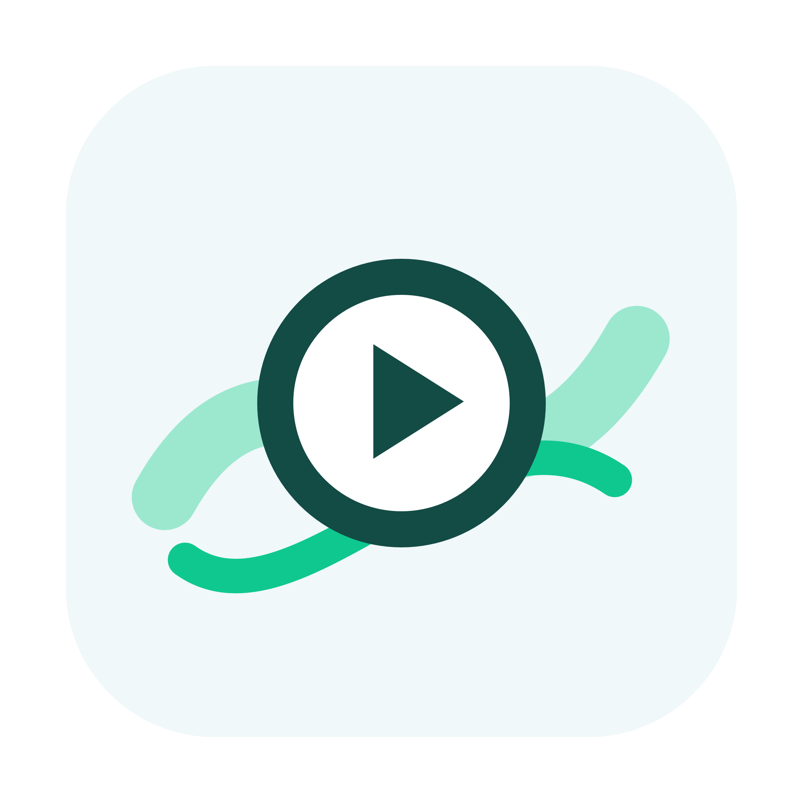
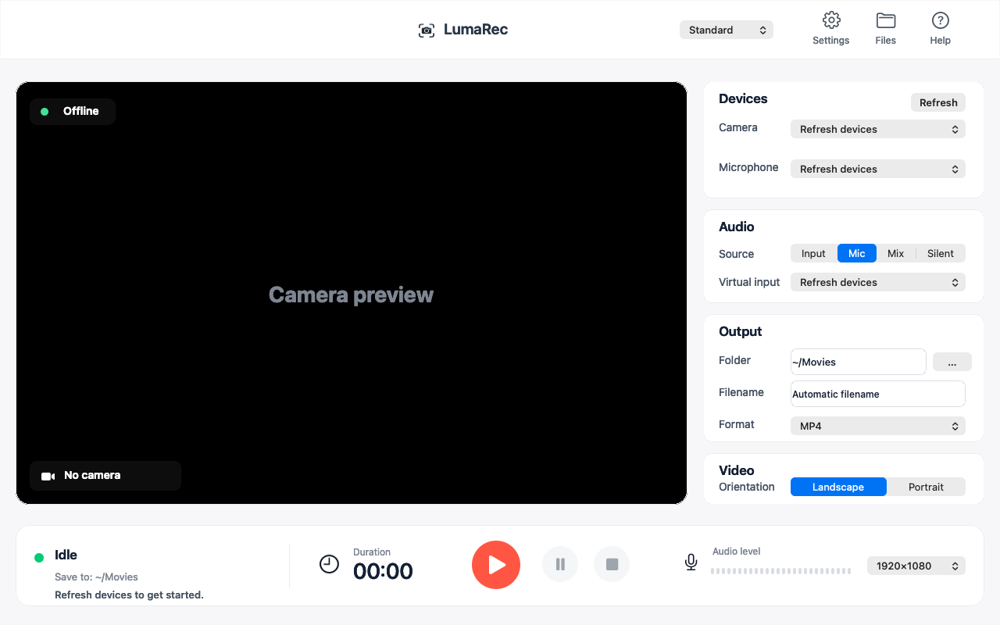

<p align="center"></p>
<h1 align="center">LumaRec</h1>
<p align="center">A native Mac camera recorder. Preview, record, and save MP4 locally.</p>
<p align="center">English · <a href="README.zh-CN.md">简体中文</a></p>



LumaRec records your camera and microphone using the media frameworks built into macOS. **No Homebrew, FFmpeg, Xcode, terminal commands, accounts, or internet connection are needed to use the app.**

## Install

Requires **macOS 13 Ventura or later**, on **Apple Silicon (arm64)**. Intel is not qualified for this first release and has no download. The first stable community release, **1.0.0**, is available: [DMG](https://github.com/kangaroo-demo/LumaRec/releases/download/v1.0.0/LumaRec-1.0.0-macOS-arm64.dmg) · [ZIP](https://github.com/kangaroo-demo/LumaRec/releases/download/v1.0.0/LumaRec-1.0.0-macOS-arm64.zip) · [SHA-256 checksums](https://github.com/kangaroo-demo/LumaRec/releases/download/v1.0.0/LumaRec-1.0.0-macOS-arm64-SHA256SUMS.txt) · [Release notes](https://github.com/kangaroo-demo/LumaRec/releases/tag/v1.0.0). See the [release handoff](docs/release-handoff.md) for qualification results.

Open the DMG, drag **LumaRec.app** to **Applications**, and open it there. With the ZIP, extract and drag the app to Applications. Allow Camera and Microphone when asked.

**This release is locally signed, not Apple Developer ID signed or notarized.** macOS may block its first launch. The normal per-app approval is **System Settings → Privacy & Security → Open Anyway**, after dismissing the initial block. Availability depends on macOS and device management policy. Do not disable system security or use terminal workarounds. Read the [bilingual offline installation guide](docs/INSTALL.md).

## Record

1. Select your camera and microphone, then wait for the preview. Speak to check the meter.
2. Choose an output folder, landscape or portrait, and a quality preset.
3. Click Record. Pause and resume as needed; click Stop to export the MP4.
4. Wait for export, then open the file or reveal it in Finder.

Recordings default to Movies. **Silent** mode records video without a microphone or Microphone permission. English is the default; **Language → 简体中文** switches the full interface.

Exports use H.264 video and AAC audio, at 30 fps. Landscape is 1920 × 1080; portrait is 1080 × 1920 with the camera picture rotated clockwise. Sources fill the frame with their aspect ratio preserved; edges are cropped from the center when needed, with no added black borders. Output dimensions do not increase the detail captured by your camera. Compact, Standard and High quality target 4, 8 and 16 Mbps video respectively; actual bitrate varies with the content.

### Optional audio inputs

**Mic** is the ordinary, ready-to-use mode. **Input** selects an existing audio input; **Mix** combines that input and your microphone. These advanced modes do **not** directly capture speaker output. To record system audio, separately configure a virtual input such as BlackHole or Loopback. This is optional and is never required for camera + microphone recording. Some device combinations cannot share one capture session; use Mic or one precombined input in that case.

### Recovery and privacy

Original MOV recordings and export settings stay in `~/Library/Application Support/LumaRec/Recordings` until a validated MP4 has been saved. Failed exports keep the original. **Help → Recover recordings** lets you choose any pending recording, including when another is damaged. Export never replaces an existing file. Crash-damaged MOV files may still be unrecoverable; retention is not a guarantee of repair. Originals are not encrypted; remove unwanted recovery folders in Finder.

The app checks the output folder and free space before capture, stops capture near low disk space, and prevents normal quit while recording or exporting. Reconnect disconnected devices and click Refresh. If permission is denied, enable it in **System Settings → Privacy & Security → Camera / Microphone**; Silent needs only Camera access.

LumaRec has no analytics, account service, cloud upload, auto updater, or runtime download. Only the GitHub help action opens a website. Media processing stays on your Mac.

## Build and verify (developers only)

Command Line Tools with Swift 5.9+ are required to build; app users do not need them.

```sh
swift run LumaRecChecks
./scripts/build-app.sh --archive --native
./scripts/verify-package.sh "$PWD/dist/LumaRec-1.0.0-macOS-arm64.dmg" "$PWD/work/dmg-verification"
```

On an Apple Silicon build Mac, this command produces the arm64 app, signs locally, and creates DMG, ZIP, build metadata and SHA-256 checksums. The optional universal development build is not a qualified first-release download. No third-party runtime is bundled. [Release procedure](docs/RELEASING.md) covers optional Developer ID signing and notarization. [Contributing](CONTRIBUTING.md) covers testing.

Automated tests generate and decode synthetic media with Apple's frameworks. Final-package verification runs the extracted app with an empty inherited environment and only system PATH. Hardware capture, audible playback/lip-sync and the downloaded app's first-open approval are reported separately; synthetic checks are not camera acceptance.

[MIT License](LICENSE) · [Third-party notices](THIRD_PARTY_NOTICES.md)
