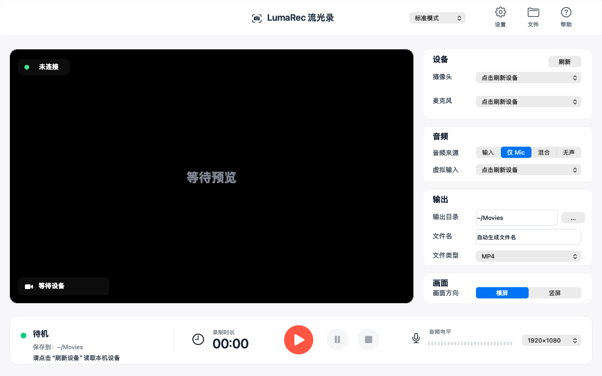

<p align="center"></p>
<h1 align="center">LumaRec · 流光录</h1>
<p align="center">原生 Mac 摄像头录像工具，在本机预览、录制并保存 MP4。</p>
<p align="center"><a href="README.md">English</a> · 简体中文</p>



LumaRec 使用 macOS 自带媒体框架录制摄像头和麦克风。**使用应用无需 Homebrew、FFmpeg、Xcode、终端命令、账号或网络。**

## 安装

支持 **macOS 13 Ventura 及更新版本**，首版仅提供 **Apple 芯片（arm64）**下载。Intel 尚未完成验收，暂无下载。1.0.0 目前为候选版本，验收结果见[发布交接记录](docs/release-handoff.md)。尚未发布公开稳定版，DMG/ZIP 候选包已准备在项目 Release 草稿中供复核。

打开 DMG，将 **LumaRec.app** 拖入**应用程序**，再从那里打开。使用 ZIP 时，先解压，再将应用拖入“应用程序”。系统询问时允许摄像头和麦克风访问。

**此候选包仅有本地临时签名，未使用 Apple Developer ID 签名，也未经过 Apple 公证。** macOS 可能拦截首次启动。关闭初始拦截提示后，正常的单应用允许路径为**系统设置 → 隐私与安全性 → 仍要打开**。此选项是否可用取决于 macOS 版本及设备管理策略，仍需对实际下载包验收。请勿关闭系统安全机制或使用终端绕过。详见[英中离线安装说明](docs/INSTALL.md)。

## 录制

1. 选择摄像头和麦克风，等待预览，对着麦克风说话检查电平。
2. 选择保存目录、横竖屏及质量。
3. 点击录制，可暂停或继续，点击停止后导出 MP4。
4. 等待导出完成，再打开文件或在 Finder 中查看。

默认保存到“影片”。**无声**模式无需麦克风或麦克风权限。界面默认英文，通过 **Language → 简体中文** 切换完整中文界面。

输出为 H.264 视频与 AAC 音频，30 fps。横屏 1920 × 1080；竖屏 1080 × 1920，画面顺时针旋转。源画面保持比例铺满，必要时居中裁掉边缘，不添加黑边，输出尺寸不会增加摄像头的实际细节。轻量、标准、高质量的视频目标码率分别为 4、8、16 Mbps，实际码率随画面内容变化。

### 可选音频输入

**麦克风**是基础开箱即用模式。**输入**选择现有音频输入；**混合**将该输入和麦克风混合。这些高级模式**不能直接捕获扬声器输出**。如需录系统声音，可另行配置 BlackHole 或 Loopback 等虚拟输入；这是可选功能，摄像头加麦克风录制无需虚拟驱动。部分设备组合不能共用同一采集会话，可改用麦克风或一个预先混合的输入。

### 恢复与隐私

原始 MOV 和导出配置保存在 `~/Library/Application Support/LumaRec/Recordings`，直到 MP4 导出验证成功。失败时保留原文件，可通过**帮助 → 恢复录制**选择任意待恢复素材，不会被另一条损坏文件堵住。导出不覆盖已有文件。崩溃损坏的 MOV 仍可能无法恢复；保留不代表一定能修复。原始素材未加密，不再需要时可在 Finder 删除对应恢复目录。

录制前检查输出目录及空间，磁盘接近写满时结束采集，录制或导出时阻止正常退出。设备断开后重新连接并点击刷新；拒绝权限后可前往**系统设置 → 隐私与安全性 → 摄像头 / 麦克风**允许访问。“无声”只需摄像头权限。

无统计分析、账号、云上传、自动更新或运行时下载。只有 GitHub 帮助操作会打开网页，媒体处理全部在本机完成。

## 构建与验证（仅开发者需要）

构建需带 Swift 5.9+ 的 Command Line Tools；普通应用用户不需要安装。

```sh
swift run LumaRecChecks
./scripts/build-app.sh --archive --native
./scripts/verify-package.sh "$PWD/dist/LumaRec-1.0.0-macOS-arm64.dmg" "$PWD/work/dmg-verification"
```

在 Apple 芯片 Mac 上，此命令构建 arm64 应用，执行本地签名，并产出 DMG、ZIP、构建信息和 SHA-256。可选的通用开发构建不作为首版已验收下载。无第三方运行组件。可选 Developer ID 签名和公证流程见[发布说明](docs/RELEASING.md)，开发约定见[参与贡献](CONTRIBUTING.md)。

自动测试使用 Apple 框架生成并解码合成素材。最终包验证在剥离继承环境、仅保留系统 PATH 的条件下运行解包后的应用。硬件录制、可听声音与口型同步，以及下载后首次允许打开，均单独报告；合成测试不等于摄像头验收。

[MIT 许可证](LICENSE) · [第三方说明](THIRD_PARTY_NOTICES.md)
